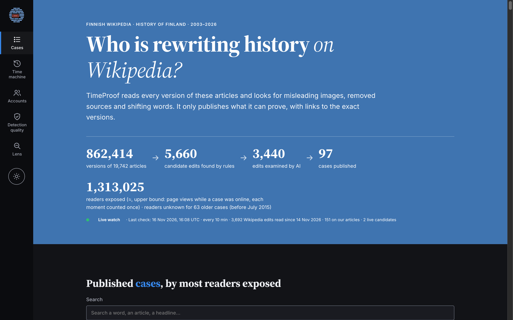
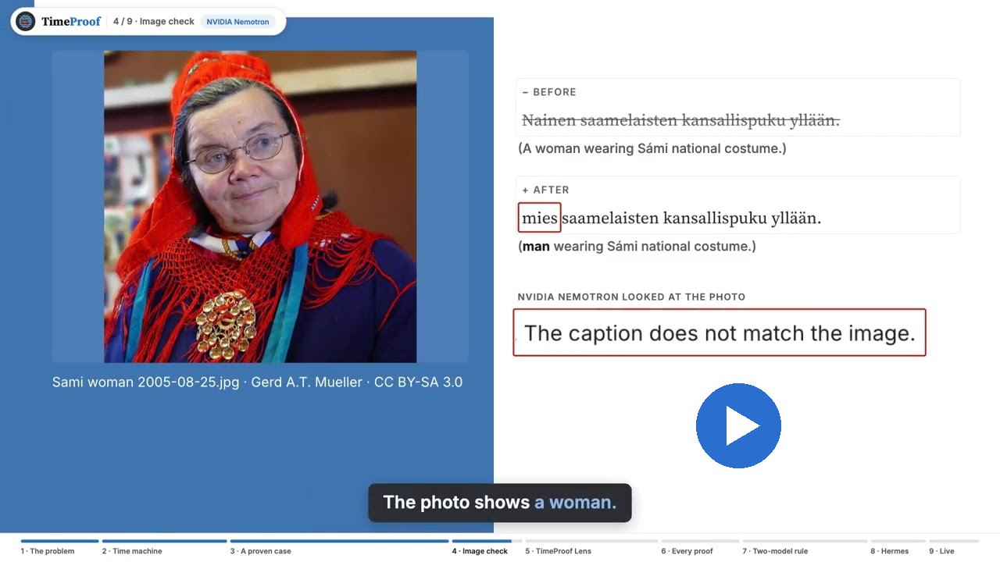
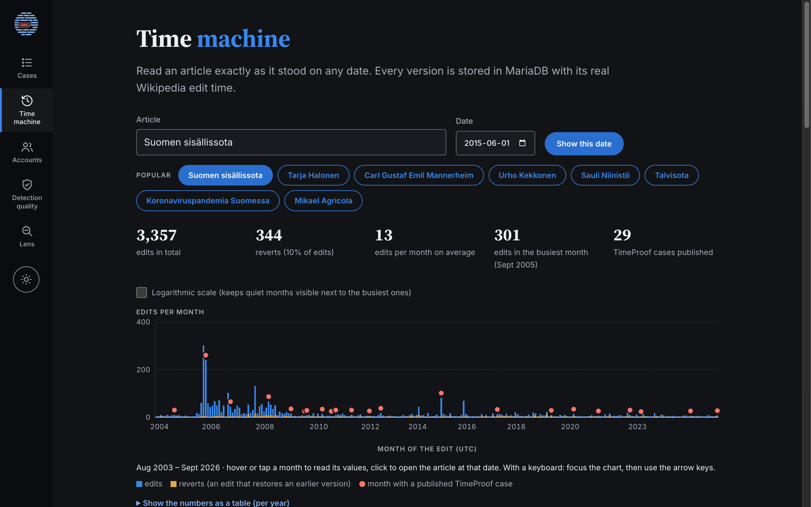
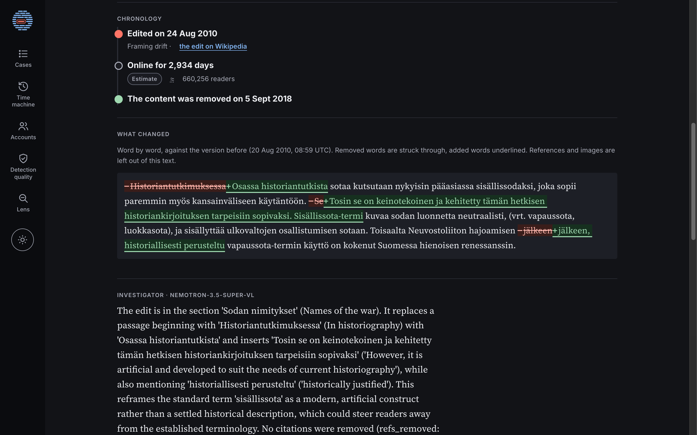
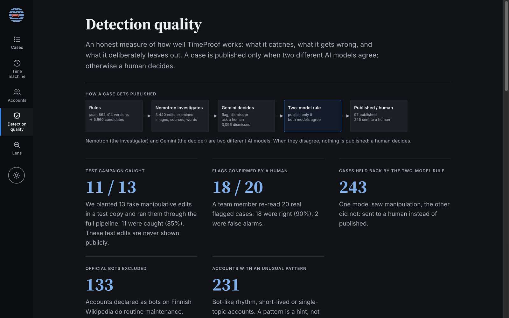

<p align="center">
  <picture>
    <source media="(prefers-color-scheme: light)" srcset="docs/assets/light/hero.svg">
    
  </picture>
</p>

## Table of contents

1. [Overview](#overview)
2. [Demo video](#demo-video)
3. [Features](#features)
4. [How a case gets published](#how-a-case-gets-published)
5. [Architecture](#architecture)
6. [Getting started](#getting-started)
7. [Repository layout](#repository-layout)
8. [Ground rules](#ground-rules)
9. [Built with](#built-with)
10. [Credits and licenses](#credits-and-licenses)
11. [Team](#team)

---

TimeProof shows who is rewriting history on Wikipedia (when, how, and with the evidence) and only publishes what it can prove.

## Overview

Wikipedia is the world's memory, but history can be rewritten one edit at a time: a word, a photo caption, a removed source. Nobody can re-read hundreds of thousands of versions by hand.

TimeProof loads the full edit history of the Finnish Wikipedia articles on the history of Finland (862,076 revisions of 19,742 articles, from 2003 to 1 October 2026) and looks for three signals: shifting words, misleading pictures and removed sources. Each published case comes with the exact versions, a word-by-word diff, how long it stayed online and an upper bound of how many readers saw it.

Built in 48 hours at Junction 2026 by team ENLMe, for the challenge *Wikipedia Through Time* (MariaDB).

<p align="center">
  <picture>
    <source media="(prefers-color-scheme: light)" srcset="docs/assets/screenshots/home-light.png">
    
  </picture>
</p>

## Demo video

<p align="center">
  <a href="https://www.youtube.com/watch?v=mIXfgXq1Bpw">
    
  </a>
</p>

<p align="center"><a href="https://www.youtube.com/watch?v=mIXfgXq1Bpw"><b>Watch the demo on YouTube</b></a></p>

The video walks through the problem, the Time machine, a proven case, the picture check, the TimeProof Lens, the two-model rule and the live watch.

## Features

### 1. Time machine

Every revision is stored in MariaDB system-versioned tables with Wikipedia's real edit time, so one query shows any article as it stood on any day:

```sql
SELECT title, rev_id, row_start, text
FROM article FOR SYSTEM_TIME AS OF TIMESTAMP '2015-06-01 00:00:00'
WHERE page_id = 1150;
```

The page also shows the edits and reverts of the article month by month, with the months that hold a published case.

<p align="center">
  <picture>
    <source media="(prefers-color-scheme: light)" srcset="docs/assets/screenshots/time-machine-light.png">
    
  </picture>
</p>

### 2. Evidence for every case

Each case shows what changed word by word, its chronology, what each model said and a ready note for Wikipedia editors. For picture cases, Cloudinary keeps an archived copy of the picture and renders the before / after view.

<p align="center">
  <picture>
    <source media="(prefers-color-scheme: light)" srcset="docs/assets/screenshots/evidence-light.png">
    
  </picture>
</p>

### 3. Exposure

For each case: how long the version stayed online, and an upper bound of how many readers saw it (page views of the whole article, always shown with "≈").

### 4. TimeProof Lens

A bookmark that outlines the published cases on the real Wikipedia page, with a link back to the evidence.

### 5. Live watch

Hermes Agent runs next to TimeProof on the same server. Every 10 minutes it checks Wikipedia's recent changes, and it runs the human review desk on the team's private Discord channel. It orchestrates, it never judges.

### 6. Detection quality

The site publishes how well it works: planted test edits caught, flags confirmed by a human re-read, cases held back when the two models disagree.

<p align="center">
  <picture>
    <source media="(prefers-color-scheme: light)" srcset="docs/assets/screenshots/quality-light.png">
    
  </picture>
</p>

## How a case gets published

<p align="center">
  <picture>
    <source media="(prefers-color-scheme: light)" srcset="docs/assets/light/pipeline.svg">
    
  </picture>
</p>

1. **Rules.** Each version of an article is compared with the previous one. An edit becomes a candidate when a caption changes, a picture is replaced, references are removed or the watched words change.
2. **Nemotron investigates.** NVIDIA Nemotron reads the text and looks at the picture, then writes a report a human can check.
3. **Gemini decides.** Gemini reads the evidence and the report, and answers *flag*, *dismiss* or *ask a human*.
4. **Two-model rule.** The rule is applied in the code, not left to a model: a case is published only when both models agree. Otherwise a human decides.

The figures in the pictures are the ones the site showed on 16 November 2026. They are a little higher than the dataset because the live watch had added new versions.

## Architecture

<p align="center">
  <picture>
    <source media="(prefers-color-scheme: light)" srcset="docs/assets/light/architecture.svg">
    
  </picture>
</p>

- **The history.** `server/load_versions.py` writes each revision into the system-versioned `article` table with its real Wikipedia timestamp. `analysis/` and `decision/` read the same files, exchange JSONL files in `data/exchange/`, and `server/import_jsonl.py` imports the results.
- **The site.** One FastAPI server exposes the API and serves `web/` as static files. There is no build step.
- **The live watch.** Hermes Agent calls an internal route of the server on a schedule. The server reads Wikipedia's recent changes, stores the new versions and runs the same pipeline on them.

The technical reference is in [`docs/TECH.md`](docs/TECH.md).

## Getting started

### Prerequisites

- Docker with Docker Compose
- For the analysis and decision scripts only: Python 3.12 with `pip install pyarrow httpx`

No API key is needed to start: with `USE_MOCK=true` (the default), calls to the models return simulated data in the right format.

### 1. Configure

<p align="center">
  <picture>
    <source media="(prefers-color-scheme: light)" srcset="docs/assets/light/step-1.svg">
    
  </picture>
</p>

```bash
git clone https://github.com/LeopoldPichonneau/TimeProof.git
cd TimeProof
cp .env.example .env
```

In `.env`, fill in the two database passwords (`DB_PASSWORD` and `DB_ROOT_PASSWORD`). The other values can stay as they are.

### 2. Start

<p align="center">
  <picture>
    <source media="(prefers-color-scheme: light)" srcset="docs/assets/light/step-2.svg">
    
  </picture>
</p>

```bash
docker compose up --build   # site and API on http://localhost:8000
```

The database starts empty, so the pages have nothing to show yet. To look at a page with sample data, add `?mock=1` to its address, for example `http://localhost:8000/?mock=1`: the page then carries a "Sample data" badge.

### 3. Load the history

<p align="center">
  <picture>
    <source media="(prefers-color-scheme: light)" srcset="docs/assets/light/step-3.svg">
    
  </picture>
</p>

The data files are not in this repository. They come from [mariadb-wikipedia-datasets](https://github.com/MariaDB/mariadb-wikipedia-datasets): 16 parquet files, 315 MB in total. The first one (20 MB, 281 articles) is enough to try:

```bash
mkdir -p data
curl -L -o data/versions-01.parquet \
  https://github.com/MariaDB/mariadb-wikipedia-datasets/releases/download/m-2026-10/versions-01.parquet

# One article (Suomen sisällissota, 3,357 versions) takes about a minute
docker compose exec -T server python load_versions.py /data/versions-01.parquet --pages 1150
```

The Time machine now works: open `http://localhost:8000/timemachine.html?page_id=1150&as_of=2015-06-01`. Leave out `--pages` to load the whole file.

To produce real cases, set `USE_MOCK=false` in `.env`, add the keys listed in `.env.example`, then run the analysis and decision scripts and import their results:

```bash
python analysis/find_candidates.py data/versions-01.parquet   # rules: candidate edits
python analysis/fetch_images.py                                # pictures, authors, licenses
python analysis/run_nemotron.py --limit 10                     # Nemotron investigates
python decision/decide.py                                      # Gemini decides, two-model rule
docker compose exec -T server python import_jsonl.py           # into MariaDB
```

With `USE_MOCK=true` each script can be tried on its own without a key: it writes a separate mock file, which never mixes with real results and is not imported. Each folder has its own README with every command.

## Repository layout

| Folder | What it holds |
|---|---|
| [`server/`](server/) | FastAPI server and API, history loader, live watcher |
| [`db/`](db/) | MariaDB schema (system-versioned tables) |
| [`analysis/`](analysis/) | Candidate rules, picture fetching, Nemotron investigator, Cloudinary evidence |
| [`decision/`](decision/) | Gemini decider, two-model rule, exposure, account patterns, quality figures |
| [`web/`](web/) | The site: plain HTML, CSS and JavaScript, no build step |
| [`lens/`](lens/) | The TimeProof Lens bookmark and its builder |
| [`hermes/`](hermes/) | Hermes Agent jobs: live watch, review desk, hourly brief |
| [`docs/`](docs/) | Technical reference and the images of this README |
| [`.github/workflows/`](.github/workflows/) | Deployment to the server on CRACI runners |

## Ground rules

- No Wikipedia account is ever named: accounts appear only as anonymous codes.
- TimeProof never edits Wikipedia.
- Planted test edits are labelled as synthetic and never shown as real cases.
- Reader numbers are upper bounds (page views of the whole article), always shown with "≈".
- Pictures are shown with their author and license.

## Built with

| Layer | Choice |
|---|---|
| Database | MariaDB, system-versioned tables |
| Models | NVIDIA Nemotron 3.5 Super VL (investigator), Gemini API (decider) |
| Server | Python 3.12, FastAPI |
| Site | Plain HTML, CSS and JavaScript |
| Picture evidence | Cloudinary |
| Hosting and live watch | Hostinger VPS with Hermes Agent |
| CI/CD | CRACI |

## Credits and licenses

- Code: MIT, see [`LICENSE`](LICENSE).
- The versioned `article` table follows the official example [mariadb-system-versioning-wikipedia](https://github.com/MariaDB/mariadb-system-versioning-wikipedia) (MIT).
- Data: [mariadb-wikipedia-datasets](https://github.com/MariaDB/mariadb-wikipedia-datasets). Wikipedia text is under CC BY-SA 4.0. Pictures come from Wikimedia Commons, each under its own license.
- The picture in the video thumbnail is *Sami woman 2005-08-25.jpg* by Gerd A.T. Mueller, CC BY-SA 3.0.
- TimeProof is independent of Wikipedia and of the Wikimedia Foundation.

## Team

Team ENLMe, Junction 2026:

- Léopold, [@LeopoldPichonneau](https://github.com/LeopoldPichonneau)
- Maël, [@MaelCompagnon](https://github.com/MaelCompagnon)
- Nathanaël, [@Nathanael-4977](https://github.com/Nathanael-4977)
- Eléa, [@paracheelea](https://github.com/paracheelea)
